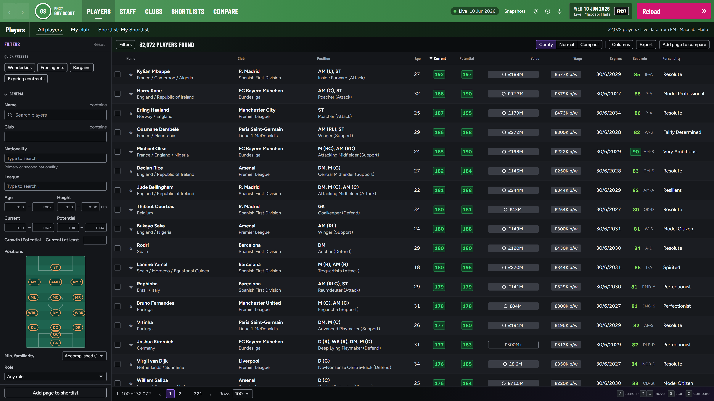
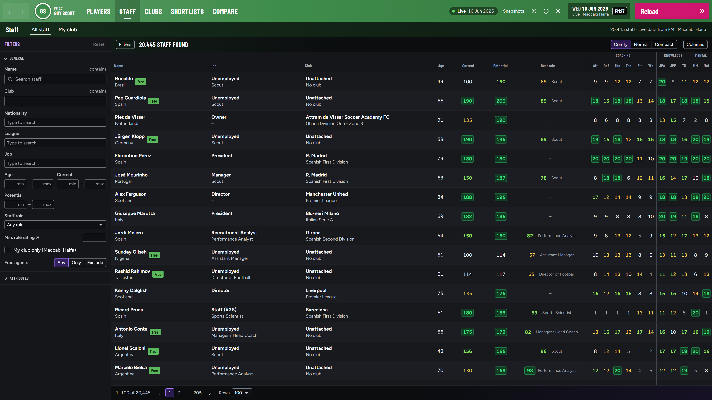

# FM27 Guy Scout

A browser-based scouting tool for **Football Manager 27**, in the spirit of FM Genie Scout.
It reads the running game (read-only) and shows every player, staff member and club, including
hidden attributes, current/potential ability, role ratings, personality, contracts and sale values.

## Download and run

1. Download **`GuyScout-FM27-Lite.exe`** (~2 MB) from the [latest release](../../releases/latest). No install needed.
2. Start FM27 and load your save.
3. Double-click `GuyScout-FM27-Lite.exe`. It starts a small local server and opens your browser at
   <http://localhost:4827>.
4. Click **Load game** (reading ~100k people takes a few seconds).

On the first launch it downloads the Node runtime once (needs internet that one time), then runs offline.
It creates a `GuyScout-FM27-data` folder next to the exe for your settings, shortlists and snapshots, and
caches the runtime in `%LOCALAPPDATA%\GuyScout-FM27`. It uses its own port and folders, so it can run next to
the FM24 version.

> Windows will likely show a SmartScreen warning ("unknown publisher") and some antivirus may flag it:
> an unsigned program that reads another app's memory looks like a game trainer. It's safe and read-only;
> click **More info → Run anyway**.

Keep the console window open while you use the scout; closing it stops it.

## Requirements

- Windows x64, Football Manager 27 **27.0.x** (Steam/Epic/Game Pass).
- A modern browser (Chrome is opened automatically).

## Features

- Player search with general, contract, attribute, hidden-attribute, personality and role-rating filters.
- Player profile: colour-coded attributes, hidden attributes, CA/PA, projected attributes at potential,
  personality, player traits, position map, all role ratings, contract and release clauses, a short report.
- Staff search and profile with coaching stars and job-suitability ratings.
- Club list and profile with squad, staff and squad aggregates.
- Named shortlists with FM `.slf` import/export, side-by-side compare (up to 4), CSV/HTML export, column chooser.
- Snapshots: save the loaded database and reopen it later without FM running.
- FM27-style interface: the top bar takes your club's colours, like the game.
- Gender filter (Men by default / Women / Any) and a W badge for women's football.
- Copy a player, staff or club name with one click (copy button next to the name).
- Multiple interface languages. Switch with the language button in the top bar or in Settings.

## Notes

- **"Players that aren't in my game"**: FM27 databases always include women's football. In a save without
  women's leagues the women still exist (mostly as free agents) but the game hides them. The scout shows men only
  by default to match; switch **Gender** to Women or Any to see them.

- Read-only: the scout never writes to FM's memory or your save files, and sends nothing anywhere.
- Known gaps: player weight isn't shown, role ratings still use FM24's role list, and some staff attributes
  are marked "unverified".

## Licence and disclaimer

© 2026 Guy Chelouche. See [LICENSE](LICENSE).

**Unofficial.** FM27 Guy Scout is a fan-made tool, **not affiliated with or endorsed by Sports Interactive or
SEGA**. *Football Manager* is a trademark of Sports Interactive / SEGA. Use it at your own risk; it is provided
"as is", without warranty of any kind.
